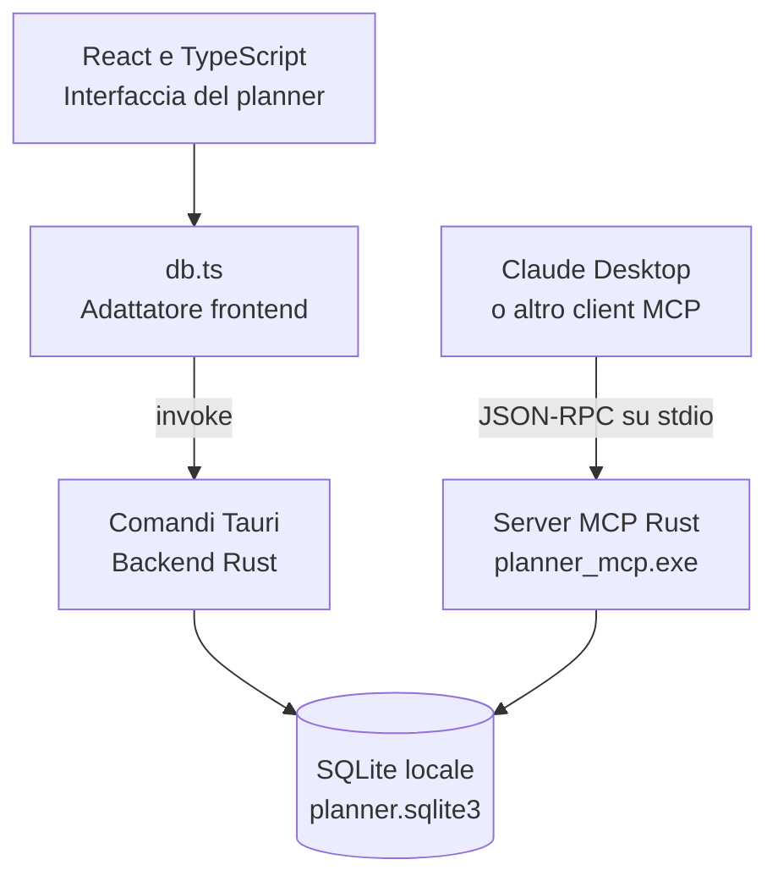
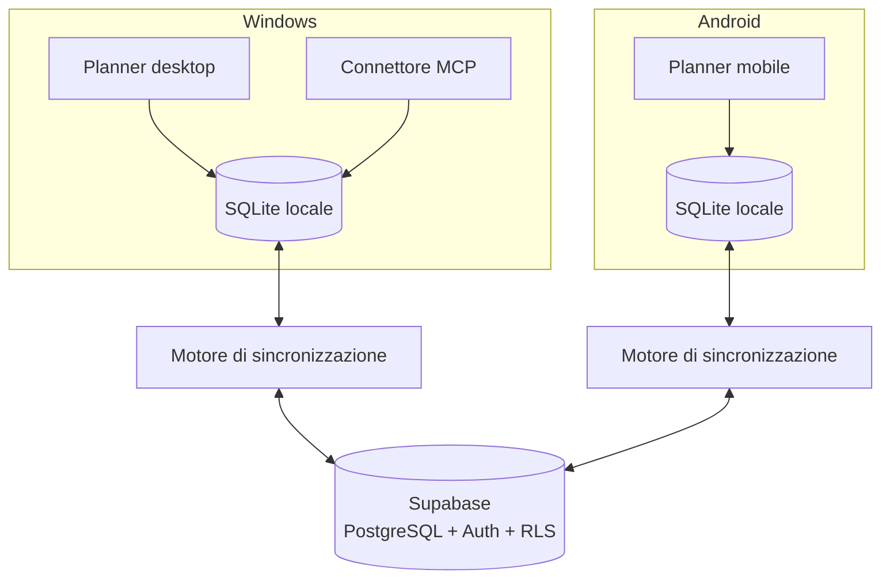

# Planner Settimanale

## Documentazione del progetto e roadmap

**Versione dell'applicazione documentata:** 0.4.0  
**Data di aggiornamento:** 13 ottobre 2026  
**Piattaforma attuale:** Windows  
**Stato:** applicazione desktop funzionante, installer offline disponibile, connettore locale MCP disponibile

---

## 1. Obiettivo del progetto

Planner Settimanale è una piccola applicazione desktop pensata per organizzare impegni, attività e note in una vista settimanale semplice. Il progetto privilegia:

- utilizzo immediato senza registrazione;
- salvataggio locale e funzionamento senza connessione;
- interfaccia simile a un planner cartaceo;
- controllo diretto dei dati da parte dell'utente;
- integrazione con assistenti AI attraverso uno standard aperto;
- possibilità di estendere in futuro la stessa base verso Android e sincronizzazione cloud.

L'applicazione usa SQLite come archivio locale. Il frontend non accede direttamente al file: comunica con il backend Rust tramite i comandi Tauri. Il connettore MCP usa lo stesso database e permette a Claude Desktop, e in futuro ad altri client MCP, di leggere e modificare il planner.

---

## 2. Funzioni già implementate

### 2.1 Planner settimanale

- Apertura automatica sulla settimana corrente.
- Colonne complete da lunedì a venerdì.
- Sabato e domenica disposti nella sesta colonna.
- Navigazione alla settimana precedente o successiva.
- Pulsante **Oggi** per tornare alla settimana corrente.
- Evidenziazione del giorno corrente.
- Area note associata a ciascuna settimana.

### 2.2 Inserimento e modifica degli impegni

- Inserimento diretto nella riga selezionata.
- `Invio` per salvare.
- `Maiusc+Invio` per aggiungere una nuova riga nel testo.
- `Esc` per annullare la modifica.
- Click su una voce esistente per modificarla.
- Click destro per aprire il menu contestuale.
- Spostamento dell'impegno in un altro giorno della settimana.
- Duplicazione ed eliminazione.
- Impostazione e rimozione dell'orario.
- Posizionamento verticale indicativo in base all'orario.

### 2.3 Attività completabili

Una voce che comincia con `[]` oppure `[ ]` viene interpretata come attività:

```text
[] Chiamare il commercialista
```

L'interfaccia mostra una checkbox. L'attività può essere completata o riaperta sia dal planner sia attraverso il connettore AI.

### 2.4 Orari

Il parser riconosce un orario iniziale scritto nel formato `HH:MM`, anche dopo il marcatore della checkbox:

```text
18:30 Cena con Luca
[] 10:00 Inviare il preventivo
```

Questo valore viene conservato come `detected_time`. L'orario scelto dal menu contestuale viene invece registrato come `scheduled_time` e determina anche la posizione verticale della voce.

Nella versione attuale la posizione è calcolata per ora intera con la formula `max(ora - 7, 0)`. I minuti vengono visualizzati ma non producono ancora uno spostamento frazionario.

### 2.5 Note settimanali

- Ogni settimana ha un campo note separato.
- Il testo viene salvato dopo circa 250 ms di inattività.
- Viene effettuato un salvataggio anche alla perdita del focus e al cambio di settimana.
- Il connettore MCP può aggiungere punti elenco alle note.
- Il connettore evita duplicati identici senza distinguere maiuscole e minuscole.

### 2.6 Barra dei menu

La barra superiore è stata introdotta come punto di accesso per le funzioni attuali e future.

**File**

- Esporta dati.
- Importa dati… (anteprima del file JSON, unione con i dati esistenti, backup SQLite automatico prima dell'importazione).

**Visualizza**

- Tema chiaro.
- Tema scuro.
- Tema di sistema.

**Aiuto**

- Informazioni sul software.
- Changelog incorporato.
- Controlla aggiornamenti… (verifica le release firmate su GitHub, scarica e installa la nuova versione).

### 2.7 Temi

La preferenza viene memorizzata nel `localStorage` con la chiave `planner-theme`.

- **Chiaro:** usa sempre la tavolozza chiara.
- **Scuro:** usa sempre la tavolozza scura.
- **Sistema:** segue `prefers-color-scheme` e reagisce alle modifiche del sistema operativo.

La versione 0.3.1 ha aumentato contrasto e luminosità dei colori nella parte superiore dei giorni nel tema scuro.

### 2.8 Esportazione

Il comando **File → Esporta dati…** genera un JSON contenente:

- tutte le voci di tutte le settimane;
- posizione;
- orari rilevati e programmati;
- tipo della voce;
- stato completato;
- note settimanali;
- versione dello schema di esportazione.

Il formato corrente è identificato da:

```json
{
  "format": "planner-settimanale",
  "schema_version": 1
}
```

Dalla versione 0.4.0, **File → Importa dati…** apre i JSON esportati, li valida e mostra un'anteprima. Dopo conferma, esegue un backup SQLite e aggiunge in una transazione le voci non identiche. Gli ID importati vengono rigenerati; le note nuove sono aggiunte a quelle esistenti.

### 2.9 Installer offline

La build Windows genera un installer NSIS `.exe` che include l'installer offline di Microsoft Edge WebView2. L'installazione può quindi essere eseguita anche su un computer senza connessione, con un aumento della dimensione del file.

Il nome dell'installer attuale è:

```text
Planner Settimanale_0.4.0_x64-setup.exe
```

L'identificatore stabile dell'applicazione è `it.planner.settimanale`. Installare una nuova versione sopra quella precedente mantiene il percorso dati e il database esistente.

---

## 3. Architettura attuale



### 3.1 Tecnologie

| Area | Tecnologia | Ruolo |
|---|---|---|
| Interfaccia | React 19 | Componenti e stato dell'interfaccia |
| Linguaggio frontend | TypeScript | Tipizzazione e logica dell'interfaccia |
| Build frontend | Vite | Server di sviluppo e bundle |
| Contenitore desktop | Tauri 2 | Finestra nativa e collegamento frontend/backend |
| Backend | Rust | Comandi applicativi, database ed esportazione |
| Database | SQLite tramite `rusqlite` | Persistenza locale |
| Integrazione AI | MCP tramite `rmcp` | Strumenti utilizzabili dagli assistenti |
| Runtime asincrono MCP | Tokio | Esecuzione del server MCP |
| Installer | NSIS | Pacchetto Windows `.exe` |
| Web runtime | WebView2 | Rendering dell'interfaccia su Windows |

### 3.2 Organizzazione dei file

```text
APP PLANNER/
├─ src/
│  ├─ App.tsx             Interfaccia, menu, dialoghi e stato principale
│  ├─ UpdateDialog.tsx    Dialogo "Controlla aggiornamenti" (plugin updater)
│  ├─ db.ts               Chiamate TypeScript ai comandi Tauri
│  ├─ date.ts             Calcoli e formattazione delle settimane
│  ├─ parser.ts           Riconoscimento checkbox e orari
│  ├─ style.css           Layout, temi e componenti grafici
│  └─ main.tsx            Avvio React
├─ src-tauri/
│  ├─ src/lib.rs          Database e comandi del programma desktop
│  ├─ src/importing.rs    Importazione JSON (anteprima, unione) e backup SQLite
│  ├─ src/notes.rs        Salvataggio delle note con unione delle modifiche esterne
│  ├─ src/main.rs         Avvio dell'applicazione Tauri
│  ├─ src/bin/
│  │  └─ planner_mcp.rs   Server MCP indipendente
│  ├─ capabilities/       Permessi Tauri
│  ├─ icons/              Icone per desktop e mobile
│  ├─ Cargo.toml          Dipendenze Rust
│  └─ tauri.conf.json     Configurazione app e installer
├─ mcp-extension/
│  ├─ manifest.json       Metadati dell'estensione MCP
│  ├─ server/             Eseguibile MCP distribuito
│  └─ *.dxt               Pacchetti installabili in Claude Desktop
├─ tests/
│  └─ test_mcp.py         Test end-to-end del protocollo MCP
├─ docs/
│  ├─ DOCUMENTAZIONE_PROGETTO_E_ROADMAP.md   Questo documento
│  └─ MCP_CLAUDE.md       Installazione del connettore in Claude Desktop
├─ .github/workflows/
│  └─ test.yml            Test automatici su GitHub Actions
├─ README.md              Istruzioni rapide di sviluppo e utilizzo
└─ STATO_LAVORI.md        Stato dei lavori, comandi, cronologia, punti aperti
```

Esclusi da git: `.signing/` (chiave privata di firma), `release-artifacts/` (installer e firme, pubblicati come asset delle Releases), i pacchetti `mcp-extension/*.dxt` e `mcp-extension/server/*.exe`.

---

## 4. Logica dell'applicazione

### 4.1 Caricamento di una settimana

1. Il frontend calcola il lunedì della settimana richiesta.
2. `App.tsx` chiama `loadWeek()` in `db.ts`.
3. `db.ts` esegue `invoke('load_week')` tramite Tauri.
4. Rust interroga le voci filtrando `week_start`.
5. Le voci vengono ordinate per giorno, posizione e ID.
6. Rust carica anche le note della settimana.
7. React distribuisce le voci nelle sette giornate.

### 4.2 Salvataggio di una voce

1. L'utente seleziona una riga e scrive il testo.
2. `parser.ts` determina se la voce è testo normale o attività.
3. Lo stesso parser cerca un eventuale orario iniziale.
4. Il frontend invia contenuto, giorno e posizione al comando Rust `add_entry`.
5. Rust inserisce la voce in SQLite.
6. Il frontend ricarica la settimana dal database.

Questa ricarica dopo ogni modifica mantiene lo stato mostrato allineato a quello realmente salvato.

### 4.3 Posizione delle voci

Ogni voce contiene un numero intero `position`. La griglia usa righe alte 33 pixel. Il frontend calcola gli spazi vuoti confrontando la posizione della voce con il cursore corrente.

- Una voce inserita cliccando una riga vuota riceve la posizione corrispondente.
- Una voce senza orario spostata in un altro giorno viene aggiunta dopo le altre.
- Una voce con orario mantiene la posizione programmata.
- Impostare un orario ricalcola la posizione in base all'ora.

### 4.4 Sincronizzazione con modifiche esterne

Il connettore MCP scrive direttamente nello stesso database. Per mostrare queste modifiche senza riavviare il planner:

- il frontend ricarica voci e note ogni 3 secondi e quando la finestra torna in primo piano;
- le note lette dal database sostituiscono quelle nel campo solo se nel campo non ci sono modifiche non ancora salvate. Per saperlo, l'app ricorda per ogni settimana la "base", cioè l'ultimo testo letto o salvato nel database;
- quando il testo esterno arriva mentre il campo è attivo, il cursore resta dove si trovava.

**Salvataggio delle note senza perdite** (dalla correzione del 13/10/2026):

- `save_notes` riceve il testo del campo e la base. In una transazione esclusiva confronta la base con il contenuto attuale del database.
- Se nel frattempo il connettore MCP (o un'importazione) ha aggiunto righe, queste vengono **unite in fondo** al testo dell'utente invece di essere cancellate. Il comando restituisce il testo finale, che l'app mostra nel campo.
- Le righe che l'utente ha cancellato dal campo e che erano già nella base non ricompaiono.
- I salvataggi delle note partono uno alla volta. Ognuno usa la base aggiornata dal precedente, così non si creano doppioni se si continua a scrivere durante un salvataggio.
- Mentre le note della settimana non sono ancora caricate, il campo è in sola lettura.

La logica di unione è in `src-tauri/src/notes.rs`, con i suoi test.

### 4.5 Persistenza e concorrenza

SQLite viene configurato con:

```sql
PRAGMA journal_mode=WAL;
PRAGMA synchronous=FULL;
```

WAL permette al planner e al connettore MCP di accedere allo stesso database con minori blocchi fra letture e scritture. Il connettore imposta anche un `busy_timeout` di 5 secondi.

Il backend Tauri conserva una singola connessione protetta da `Mutex`. In questo modo i comandi dell'applicazione non usano contemporaneamente la stessa connessione Rust.

---

## 5. Database

### 5.1 Posizione su Windows

```text
%APPDATA%\it.planner.settimanale\planner.sqlite3
```

Il file viene creato al primo avvio dell'applicazione.

### 5.2 Tabella `entries`

| Campo | Tipo | Funzione |
|---|---|---|
| `id` | INTEGER | Chiave primaria locale |
| `week_start` | TEXT | Lunedì della settimana, formato `YYYY-MM-DD` |
| `day_date` | TEXT | Giorno della voce |
| `content` | TEXT | Testo originale |
| `position` | INTEGER | Posizione verticale nella giornata |
| `detected_time` | TEXT nullable | Orario riconosciuto nel testo |
| `scheduled_time` | TEXT nullable | Orario impostato esplicitamente |
| `kind` | TEXT | `text` oppure `task` |
| `completed` | INTEGER | `0` da fare, `1` completata |

Indice principale:

```sql
CREATE INDEX entries_week_day
ON entries(week_start, day_date, position);
```

### 5.3 Tabella `weekly_notes`

| Campo | Tipo | Funzione |
|---|---|---|
| `week_start` | TEXT | Chiave primaria della settimana |
| `content` | TEXT | Contenuto completo delle note |

Il salvataggio usa un'operazione UPSERT: crea la nota se manca oppure aggiorna quella esistente.

---

## 6. Comandi Tauri disponibili

| Comando | Funzione |
|---|---|
| `load_week` | Carica voci e note di una settimana |
| `add_entry` | Crea una voce |
| `update_entry` | Modifica testo, tipo e orario rilevato |
| `set_completed` | Completa o riapre un'attività |
| `delete_entry` | Elimina una voce |
| `duplicate_entry` | Duplica una voce nello stesso giorno |
| `move_entry` | Sposta una voce in un altro giorno |
| `set_entry_time` | Imposta o rimuove l'orario programmato |
| `save_notes` | Salva le note settimanali unendo le righe aggiunte da fuori nel frattempo (vedi §4.4); restituisce il testo salvato |
| `export_data` | Esporta tutto il database in JSON |
| `inspect_import` | Legge un file JSON esportato e ne mostra il contenuto prima dell'importazione |
| `import_data` | Unisce voci e note del file JSON ai dati esistenti, senza sostituirli |
| `backup_data` | Crea una copia di sicurezza del database SQLite nella cartella `backups/` |

I permessi Tauri attuali (`src-tauri/capabilities/default.json`) autorizzano:

- le funzioni di base (`core:default`);
- il salvataggio dello stato della finestra (`window-state:default`);
- i dialoghi di salvataggio e apertura file per esportazione e importazione (`dialog:allow-save`, `dialog:allow-open`);
- il controllo, il download e l'installazione degli aggiornamenti (`updater:default`);
- il riavvio dell'app dopo l'aggiornamento (`process:allow-restart`).

---

## 7. Connettore AI tramite MCP

### 7.1 Scopo

Il connettore è un processo Rust separato dall'interfaccia. Comunica attraverso MCP usando JSON-RPC su standard input/output. Questa scelta evita una dipendenza specifica da Claude: qualsiasi client che supporti un server MCP locale su `stdio` potrà integrare lo stesso eseguibile.

### 7.2 Strumenti esposti

| Strumento | Operazione |
|---|---|
| `list_tasks` | Elenca attività in un intervallo di date |
| `create_task` | Crea una nuova attività con data e orario facoltativo |
| `set_task_completed` | Completa o riapre un'attività usando l'ID |
| `add_weekly_notes` | Inserisce nelle note gli impegni senza data precisa |

### 7.3 Regole applicate dal connettore

- Leggere prima le attività quando serve evitare duplicati.
- Non inventare una data per un impegno ambiguo.
- Inserire nelle note settimanali gli impegni ancora da programmare.
- Normalizzare date in `YYYY-MM-DD` e orari in `HH:MM`.
- Usare transazioni per l'aggiornamento delle note.
- Restituire risultati ed errori in forma leggibile dal client AI.

### 7.4 Test MCP

`tests/test_mcp.py` crea un database temporaneo e verifica il flusso completo:

1. inizializzazione MCP;
2. creazione di un'attività;
3. lettura dell'attività;
4. completamento;
5. inserimento di note;
6. riconoscimento del duplicato nelle note.

La variabile `PLANNER_DB_PATH` permette al test di indirizzare il server verso il database temporaneo senza toccare i dati reali.

---

## 8. Versioni sviluppate

### Versione 0.1.0

- Prima versione del planner offline.
- Database SQLite.
- Scrittura diretta nelle giornate.
- Checkbox, orari, note ed esportazione JSON.

### Versione 0.2.0

- Connettore MCP per Claude Desktop.
- Lettura, creazione e completamento delle attività tramite AI.
- Aggiornamento automatico dell'interfaccia dopo modifiche esterne.

### Versione 0.3.0

- Barra dei menu.
- Informazioni sul software e changelog.
- Temi chiaro, scuro e sistema.
- Strumento MCP per aggiungere alle note gli impegni senza data.

### Versione 0.3.1

- Miglioramento del contrasto delle intestazioni nel tema scuro.
- Colori dei giorni più luminosi e leggibili.

### Versione 0.4.0

- Importazione JSON con anteprima, validazione e unione dei dati.
- Backup SQLite prima di ogni importazione.
- Menu Aiuto → Controlla aggiornamenti, download e installazione di pacchetti firmati.
- Installer `.exe` e firma `.sig` per ogni build firmata.

---

## 9. Compilazione e verifica

### 9.1 Requisiti Windows

- Node.js LTS e npm.
- Rust tramite rustup.
- Toolchain Rust `stable-msvc`.
- Microsoft C++ Build Tools.
- Microsoft Edge WebView2.

### 9.2 Avvio in sviluppo

```powershell
# dalla cartella del progetto
npm install
npm run tauri dev
```

### 9.3 Controlli frontend

```powershell
npm run build
```

Il comando esegue la compilazione TypeScript e la build Vite.

### 9.4 Controlli Rust

```powershell
cd src-tauri
cargo check --bins
cd ..
```

### 9.5 Test del connettore

Il test usa il binario MCP release:

```powershell
cargo build --release --bin planner_mcp --manifest-path src-tauri\Cargo.toml
python tests\test_mcp.py
```

### 9.6 Creazione installer

```powershell
npm run tauri build
```

Risultato:

```text
src-tauri\target\release\bundle\nsis\Planner Settimanale_0.4.0_x64-setup.exe
```

---

## 10. Limiti attuali

- Non esiste ancora sincronizzazione cloud.
- Gli ID delle voci sono numerici e locali, quindi non sono ancora adatti alla sincronizzazione fra più dispositivi.
- Le eliminazioni rimuovono subito la riga; un sistema cloud richiederà eliminazioni logiche tramite `deleted_at`.
- Il posizionamento orario considera l'ora ma non i minuti.
- Il layout richiede almeno 900 pixel di larghezza e deve essere riprogettato per telefoni.
- Il server MCP accede direttamente allo schema SQLite; alcune regole sono duplicate rispetto al backend Tauri.
- Il pacchetto MCP corrente è dedicato a Windows.
- L'aggiornamento esterno avviene tramite polling ogni 3 secondi.
- Il controllo degli aggiornamenti richiede una release GitHub pubblica con `latest.json`, `.exe` e `.sig`; la pubblicazione è separata dalla build locale.

---

## 11. Architettura futura consigliata

La direzione consigliata è **local first**: ogni dispositivo conserva un database locale e può lavorare offline. Il cloud sincronizza i cambiamenti quando la rete è disponibile.



### 11.1 Perché mantenere SQLite

- Avvio rapido.
- Uso completo senza rete.
- Dati disponibili anche se il servizio cloud è temporaneamente irraggiungibile.
- Continuità con l'applicazione già realizzata.
- Possibilità di esportare e recuperare i dati localmente.

### 11.2 Cloud consigliato: Supabase

Supabase è adatto perché fornisce:

- database PostgreSQL;
- autenticazione utenti;
- API per leggere e scrivere i record;
- Row Level Security per separare i dati degli utenti;
- notifiche in tempo reale;
- una struttura relazionale vicina all'attuale SQLite.

Il database remoto non deve sostituire SQLite durante l'uso normale: deve ricevere e distribuire le modifiche.

### 11.3 Ruolo possibile di GitHub

GitHub può contenere backup JSON versionati, ma non è consigliato come database operativo.

Uso appropriato:

- backup manuale o periodico;
- archivio delle esportazioni;
- cronologia leggibile delle copie di sicurezza;
- prototipo personale su un unico account.

Problemi come database principale:

- ogni aggiornamento di un file produce un commit;
- due dispositivi possono aggiornare lo stesso file e generare conflitti;
- l'app dovrebbe custodire un token GitHub;
- l'API applica limiti e raccomanda di non effettuare polling frequente;
- non offre query per singolo impegno come un database;
- una piccola modifica richiede normalmente di leggere e sostituire l'intero file JSON.

La soluzione proposta è quindi:

```text
SQLite locale + Supabase per la sincronizzazione + JSON/GitHub facoltativo per i backup
```

---

## 12. Modifiche necessarie per la sincronizzazione

### 12.1 Evoluzione dello schema locale

Per non rompere gli ID esistenti, si può conservare `id INTEGER` e aggiungere:

| Campo | Funzione |
|---|---|
| `cloud_id` | UUID stabile condiviso tra dispositivi |
| `user_id` | Proprietario del dato |
| `created_at` | Data di creazione |
| `updated_at` | Ultimo aggiornamento |
| `deleted_at` | Eliminazione logica sincronizzabile |
| `device_id` | Dispositivo che ha prodotto la modifica |
| `revision` | Versione del record |

Anche le note settimanali dovranno avere un UUID o una chiave composta da utente e settimana, oltre ai campi di aggiornamento.

### 12.2 Coda delle modifiche

Una tabella `sync_outbox` registrerà le operazioni locali ancora da inviare:

```text
CREATE / UPDATE / DELETE
```

Flusso suggerito:

1. salvare subito la modifica in SQLite;
2. aggiungere un elemento alla coda;
3. aggiornare immediatamente l'interfaccia;
4. tentare l'invio quando la rete è disponibile;
5. marcare l'operazione come sincronizzata;
6. scaricare le modifiche remote successive all'ultimo cursore noto;
7. applicarle in una transazione locale.

### 12.3 Conflitti

Prima versione consigliata:

- confronto fra `revision` e `updated_at`;
- ultima modifica valida come risoluzione automatica;
- conservazione di una copia del valore sostituito in un registro conflitti;
- messaggio all'utente soltanto quando due dispositivi hanno modificato lo stesso impegno offline.

Le note sono più soggette a conflitti perché l'intero contenuto è un solo campo. In una fase successiva potrebbe essere utile memorizzare ogni riga della nota come elemento separato.

### 12.4 Sicurezza

- Accesso tramite account utente.
- Token conservati nel portachiavi sicuro della piattaforma.
- Chiave pubblica del progetto utilizzabile nel client.
- Nessuna chiave amministrativa inclusa nell'app.
- Row Level Security basata su `user_id`.
- Connessioni solo tramite HTTPS.
- Possibilità di disconnettere un dispositivo.

---

## 13. Variante Android

### 13.1 Strategia tecnica

Tauri 2 supporta Android, quindi è possibile riutilizzare:

- componenti React;
- logica TypeScript;
- parser di attività e orari;
- funzioni sulle date;
- parte del backend Rust;
- modello SQLite;
- temi e impostazioni.

Richiederanno adattamento:

- layout;
- navigazione;
- menu contestuale, perché il click destro non esiste sul touchscreen;
- dialoghi di apertura e salvataggio file;
- percorsi del database;
- gestione sicura dei token;
- plugin Tauri da verificare su Android;
- processo di firma e distribuzione APK/AAB.

### 13.2 Interfaccia mobile proposta

- Barra superiore con data e navigazione.
- Vista di un giorno alla volta.
- Scorrimento orizzontale per cambiare giorno.
- Pulsante per aprire una panoramica della settimana.
- Pressione prolungata su una voce per aprire le azioni.
- Pulsante mobile evidente per aggiungere attività.
- Sezione note raggiungibile tramite scheda o pannello.
- Indicatori dello stato di sincronizzazione.

### 13.3 Requisiti di sviluppo Android

- Android Studio.
- Android SDK Platform.
- Android SDK Platform Tools.
- Android SDK Build Tools.
- Android SDK Command-line Tools.
- NDK side by side.
- Java configurato tramite `JAVA_HOME`.
- Variabili `ANDROID_HOME` e `NDK_HOME`.
- Target Rust Android.

Target Rust previsti:

```powershell
rustup target add aarch64-linux-android armv7-linux-androideabi i686-linux-android x86_64-linux-android
```

---

## 14. Evoluzione del connettore AI

Il protocollo MCP permette di aggiungere altri assistenti senza cambiare il formato delle operazioni principali.

### Passo intermedio

Il connettore continua a scrivere nel database SQLite Windows. Il motore di sincronizzazione invia poi le modifiche al cloud e Android le riceve.

### Passo successivo

Estrarre la logica dati in un modulo Rust condiviso fra:

- backend Tauri desktop;
- server MCP;
- eventuale backend Tauri Android;
- motore di sincronizzazione.

Questo ridurrà la duplicazione di query e regole.

### Possibili strumenti MCP futuri

- aggiornare testo, data e orario di un'attività;
- eliminare o archiviare una voce;
- leggere e modificare le note;
- cercare impegni per testo;
- proporre una pianificazione senza applicarla;
- applicare un gruppo di modifiche dopo conferma;
- leggere lo stato di sincronizzazione;
- gestire categorie e priorità.

Il connettore deve continuare a controllare i duplicati e chiedere chiarimenti quando data, settimana o significato sono ambigui.

---

## 15. Roadmap consigliata

### Fase 1 — Consolidamento desktop

1. Importazione del JSON esportato (completata nella versione 0.4.0).
2. Aggiungere backup automatici locali con rotazione.
3. Migliorare il posizionamento degli orari considerando i minuti.
4. Aggiungere categorie o colori facoltativi alle attività.
5. Aggiungere ricerca globale.
6. Aggiungere test delle migrazioni del database.
7. Estrarre un livello dati Rust condiviso fra app e MCP.

### Fase 2 — Preparazione cloud

1. Aggiungere UUID e campi temporali senza perdere i dati esistenti.
2. Introdurre migrazioni versionate dello schema.
3. Implementare eliminazioni logiche.
4. Creare la tabella della coda di sincronizzazione.
5. Separare l'interfaccia `Repository` dalla sorgente SQLite.
6. Aggiungere stato di sincronizzazione nell'interfaccia.

### Fase 3 — Account e Supabase

1. Creare progetto e tabelle Supabase.
2. Configurare autenticazione.
3. Attivare Row Level Security.
4. Implementare invio della coda locale.
5. Implementare download incrementale.
6. Gestire disconnessione, cambio account ed errori di rete.
7. Testare conflitti fra due installazioni desktop.

### Fase 4 — Android MVP

1. Inizializzare il target Android Tauri.
2. Creare il layout mobile giornaliero.
3. Collegare SQLite locale.
4. Collegare account e sincronizzazione.
5. Verificare uso offline e ripresa della rete.
6. Generare APK di test.
7. Preparare firma e pacchetto AAB per un'eventuale pubblicazione.

### Fase 5 — Integrazioni e distribuzione

1. Collegare altri client MCP.
2. Valutare importazione da calendari esterni.
3. Controllo manuale e installazione degli aggiornamenti dal menu desktop (completati nella versione 0.4.0; resta da pubblicare una release per l’updater).
4. Aggiungere backup cloud opzionale esportabile.
5. Preparare informativa privacy se l'app viene distribuita ad altri utenti.

---

## 16. Ordine pratico raccomandato

L'importazione JSON è stata completata nella versione 0.4.0. Il prossimo sviluppo dovrebbe cominciare dalla correzione dei bug aperti (vedi `STATO_LAVORI.md`) e dalla migrazione dello schema con `PRAGMA user_version`. Sono fondamentali prima del cloud perché forniscono un percorso di recupero dati e identificatori adatti a più dispositivi.

Ordine sintetico:

```text
Importazione JSON (fatta, 0.4.0)
→ correzione bug aperti
→ migrazioni e UUID
→ livello dati condiviso
→ coda di sincronizzazione
→ Supabase e account
→ layout Android
→ APK di prova
```

Questa sequenza riduce il rischio di perdere dati e permette di testare ogni livello separatamente.

---

## 17. Decisioni progettuali da mantenere

- Il planner deve restare utilizzabile offline.
- SQLite rimane la copia locale principale durante l'uso.
- Le integrazioni AI passano attraverso MCP.
- Le operazioni ambigue non devono inventare date o orari.
- I dati devono essere esportabili in un formato leggibile.
- Ogni modifica dello schema deve avere una migrazione e un test.
- Le chiavi amministrative cloud non devono essere distribuite con l'app.
- Desktop e Android devono condividere modello dati e regole, pur avendo interfacce adatte al dispositivo.

---

## 18. Stato delle verifiche della versione 0.4.0

Verifiche del 13 ottobre 2026:

- Build TypeScript e Vite completata (`npm run build`).
- Test Rust completati: 5 test sull'importazione (`cargo test`).
- Binario MCP release compilato e test MCP end-to-end su database temporaneo (`python tests/test_mcp.py`).
- Installer NSIS offline 0.4.0 generato e firmato (`.sig`), con `latest.json` per l'updater.
- Le stesse verifiche girano su GitHub Actions a ogni push (`.github/workflows/test.yml`).

Problemi noti e debolezze da correggere: vedi la sezione "Da verificare / aperto" di `STATO_LAVORI.md`.

Il documento va aggiornato insieme al changelog quando viene completata una nuova funzione o cambia l'architettura.

---

## 19. Nuovo requisito — Aggiornamenti dalla barra dei menu

**Richiesta aggiunta il 13 ottobre 2026. Stato: implementato nella versione 0.4.0; la pubblicazione delle release resta da attivare.**

L'applicazione dovrà poter essere aggiornata direttamente dalla barra dei menu, senza richiedere all'utente di scaricare e avviare manualmente un nuovo installer a ogni versione. Per ogni versione di sviluppo dovrà comunque essere generato e conservato il corrispondente installer Windows `.exe`, utile per installazioni manuali, nuove installazioni e archivio delle build.

### Esperienza prevista

1. Comando **Aiuto → Controlla aggiornamenti…**.
2. Controllo della versione disponibile online.
3. Mostrare versione installata, nuova versione e changelog, oppure indicare che non sono disponibili aggiornamenti.
4. Su scelta dell'utente, scaricare il pacchetto mostrando avanzamento ed eventuali errori.
5. Verificare la firma del pacchetto e salvare le modifiche ancora in corso prima di avviare l'installazione.
6. Chiudere l'applicazione per applicare l'aggiornamento e prevederne il riavvio, conservando database, note e impostazioni attraverso migrazioni compatibili.
7. Se manca la connessione, mostrare un messaggio e consentire di riprovare; il planner deve continuare a funzionare offline.

### Strategia tecnica proposta

- Integrare il plugin ufficiale `tauri-plugin-updater`, con i relativi permessi e comandi frontend.
- Configurare `createUpdaterArtifacts` per generare il materiale necessario agli aggiornamenti insieme agli installer.
- Firmare i pacchetti con la chiave privata conservata nell'ambiente di build e includere solo la chiave pubblica nell'applicazione.
- Pubblicare pacchetti e manifest di aggiornamento via HTTPS. GitHub Releases è una possibile sede di distribuzione da scegliere quando si implementa la funzione.
- Su Windows l'updater avvia comunque un installer per sostituire i file dell'applicazione: viene automatizzato il processo, con breve chiusura dell'app, senza installazione manuale da parte dell'utente.
- Conservare un `.exe` identificato dalla versione per ogni nuova versione di sviluppo. Generazione e archiviazione della build non implicano pubblicazione automatica sul canale degli aggiornamenti.
- Valutare canali separati stabile e sviluppo; proporre normalmente solo le versioni pubblicate nel canale selezionato.
- Prima dell'aggiornamento salvare le bozze e creare una copia di sicurezza del database. Verificare le migrazioni e la conservazione dei dati aggiornando da una versione precedente.

Questa voce precisa e amplia gli aggiornamenti automatici desktop già inclusi nella Fase 5 della roadmap. Non dipende dall'implementazione del cloud per i dati del planner e può essere anticipata rispetto ad Android.

Riferimento tecnico: [Updater ufficiale Tauri](https://v2.tauri.app/plugin/updater/).
